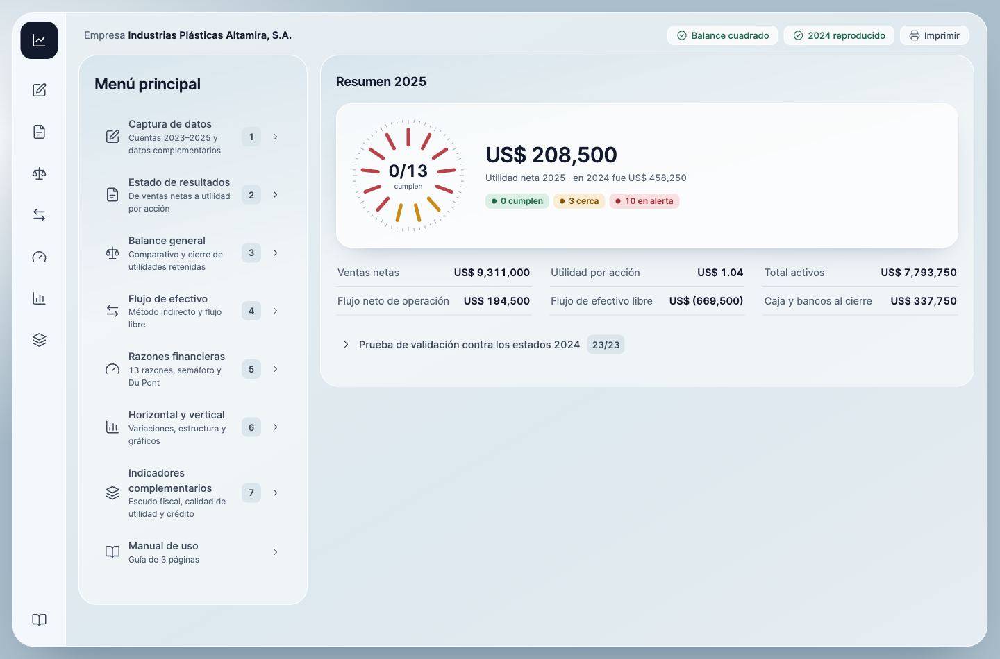

# Altamira · Análisis Financiero

Sistema web en Python que procesa los estados financieros de **Industrias Plásticas Altamira, S.A.** y genera sus análisis en dólares estadounidenses (US$). Todas las cifras se calculan a partir de las cuentas capturadas.



## Módulos

1. **Captura de datos:** cuentas 2023–2025 y datos complementarios, con alerta si el balance no cuadra.
2. **Estado de resultados:** de ventas netas a utilidad por acción.
3. **Balance general:** comparativo 2025–2024 y conciliación de utilidades retenidas.
4. **Flujo de efectivo:** método indirecto y flujo de efectivo libre.
5. **Razones financieras:** 13 razones, semáforo frente a la industria y sistema Du Pont.
6. **Análisis horizontal y vertical:** variaciones, estructura y gráficos.
7. **Indicadores complementarios:** escudo fiscal, calidad de la utilidad, Du Pont descompuesto y política de crédito.

La guía completa está en el [manual de uso](docs/manual_usuario.pdf).

## Puesta en marcha

Necesita Python 3.12 o superior (desarrollado con 3.13).

```bash
git clone https://github.com/liversay/altamira-analisis-financiero.git
cd altamira-analisis-financiero
python3 -m venv .venv
.venv/bin/pip install -r requirements.txt
PORT=5050 .venv/bin/python app.py
```

Abra http://127.0.0.1:5050. En Windows (PowerShell):

```powershell
py -m venv .venv
.venv\Scripts\pip install -r requirements.txt
$env:PORT=5050; .venv\Scripts\python app.py
```

## Pruebas

```bash
.venv/bin/pytest
```

En Windows: `.venv\Scripts\pytest`. La prueba de aceptación (`tests/test_validacion_2024.py`) verifica que el sistema reproduzca los estados de 2024.

## Estructura

| Carpeta o archivo | Contenido |
|---|---|
| `altamira/` | Motor financiero en Python puro, sin dependencias web |
| `app.py` | Rutas de la aplicación Flask |
| `templates/`, `static/` | Interfaz |
| `data/datos_base.json` | Cuentas originales |
| `data/publicado_2024.json` | Cifras de referencia, usadas solo para validar |
| `tests/` | Pruebas con pytest |
| `docs/` | Manual de uso |
| `herramientas/` | Generadores de los datos base y del PDF del manual |

Los cambios hechos desde la aplicación se guardan en `data/datos_actuales.json`, que es local y no se sube al repositorio.

## Cómo trabajar en equipo

Se desarrolla con pruebas primero: escriba la prueba, compruebe que falla y luego programe.

1. Actualice su copia: `git switch main && git pull`
2. Cree una rama: `git switch -c nombre-del-cambio`
3. Haga el cambio y ejecute las pruebas.
4. Guarde y suba: `git add -A && git commit -m "Describe el cambio" && git push -u origin nombre-del-cambio`
5. Abra un *pull request* en GitHub para que otra persona lo revise antes de unirlo a `main`.

Si modifica `docs/manual_usuario.md`, regenere el PDF con `.venv/bin/python herramientas/generar_manual.py`.
